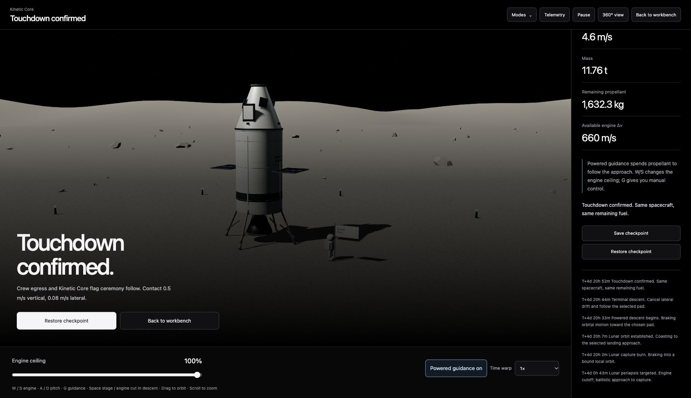
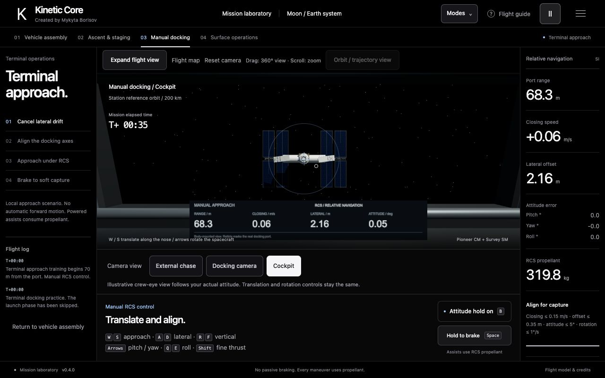
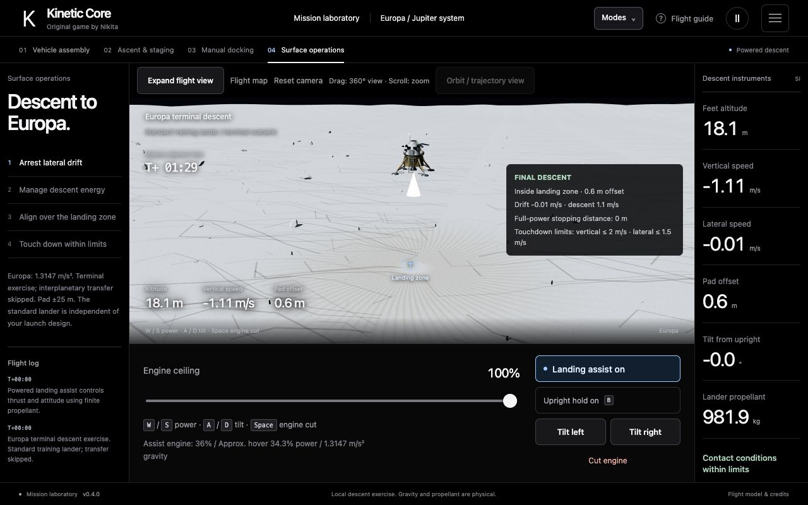

# Kinetic Core v0.4.0 — the same spacecraft to the Moon

Sole game author: **Mykyta (ropotropo)**. Andrii coordinates feedback; Codex and
specialist agents assist implementation, design and verification. This version
builds on Mykyta's preserved `codex/nikita-navigation` commit **d495fd7**.

## Playable changes

- The custom workshop uses typed compatible attachment points. Addition order
  no longer defines the vehicle. Dimensions, geometry, performance, saved files
  and flight resolve the same validated design. Legacy workshop imports migrate.
- Start Flight opens a destination/site planner. The Moon route connects a 3 s
  rollout presentation, 5 s countdown, real first 100 m handover, ascent, manual
  staging, active Earth orbit, departure window/burn, real-distance coast, lunar
  approach/capture/orbit and powered landing with one finite resource ledger.
- Four Apollo-reference Moon approaches are available. Other bodies start
  clearly labeled local custom-craft surface rehearsals, without a transfer
  claim. Legacy launch, docking, standard lander, rollout, Solar System and
  online Earth free flight modes remain accessible.
- A persistent **Modes** menu directly exposes those modes. Landing controls
  have larger labels/targets, a better-spaced power slider and an explicit
  powered **Landing assist** separate from upright hold.
- Manual docking has explicit **External chase**, **Docking camera** and
  **Cockpit** selections. The cockpit follows actual quaternion attitude and
  uses a procedural crew-eye interior, not an auto-aligned station view.
- A final interaction audit aligns button families and spacing. Touch pitch,
  Cut engine, Fine RCS and Earth yaw close practical input gaps; the mobile
  docking viewport remains visible while operating its touch controls.
- Earth/Moon flight uses a stable separate celestial depth pass and local
  floating coordinates. Official 4K Moon and Europa display maps improve close
  inspection. Europa's monochrome mosaic, coverage gaps and mission limits are
  explained in the in-game evidence panel and [EUROPA.md](EUROPA.md).
- Launch steam follows actual thrust/height; landing dust uses finite ballistic
  particles rather than atmospheric smoke on airless bodies. A successful
  integrated Moon contact enables the crew and temporary Kinetic Core text flag.
- Authorship is consistently Mykyta's. A clean-commit source export and manifest
  support future repository transfer without forgotten assets or local history.
- **About the author** presents **Микита Борисов**, Ukraine, with the existing
  spacesuit portrait and minimal visible copy. Asset provenance stays in credits.
  A reported ultrawide cockpit issue was fixed: its readout now preserves its
  proportions and has a bounded pixel size independent of the cabin frame.

## Verification

The independent [QA record](QA-V04.md) distinguishes numerical tests, actual
UI playthroughs, renderer fixtures and compatibility limits. A complete guided
browser mission used an edited, saved and loaded custom capsule (length 3.55 m)
and Taurus–Littrow: actual touchdown at **T+4 d 20 h 52 m**, **0.50 m/s** vertical
and **0.08 m/s** lateral contact, with **1,632.3 kg** main propellant remaining.
The tester manually separated depleted stages. No time-step or state-injection
hook was used for that run. It is a powered-guidance flight, not a claim of a
full unassisted manual attitude campaign.

This image is from the physical guided browser flight recorded in QA. Later
visual refinements do not turn this into evidence of an unassisted mission.

The final camera build also completed a real manual docking UI run: **T+3:22**,
**12.9 kg** RCS propellant used and **307.1 kg** remaining. The pilot corrected
lateral drift with body-axis RCS and used the powered translation brake before
soft capture. All three camera selections, actual attitude response, external
360° inspection, desktop and 390 px cockpit framing passed.

In the separate standard Europa exercise, powered assistance landed at
**0.25 / 0.04 m/s** contact with **893.6 kg** fuel remaining. A custom-spacecraft
Europa rehearsal landed at **0.35 / 0.01 m/s** with **24,584.2 kg** main fuel.
Restoring that rehearsal paused at zero engine power; leaving guidance off and
power at zero then produced a genuine unsafe **47.4 m/s** contact without using
propellant. The last active checkpoint remained available afterward.

## Physical and product limits

The integrated mission is 2D patched-conic training with a synthetic circular
Moon epoch and ideal engine pointing. Site longitude is projected into that
plane; latitude is reference metadata. It is not current ephemerides,
surveyed collision terrain, a 6DOF lunar dynamics model or real vehicle hardware.
The docking exercise separately retains 3D translation/quaternion rotation and
local Hill dynamics; it does not implement a full orbital rendezvous.

Europa's 4K display map is a downsampled monochrome USGS mosaic with mild display
processing and flat no-data fill. It is not new true-color imagery, generated
scientific detail or a terrain DEM. Surface terrain and pad facilities are
procedural illustration. Radiation, life support, samples, lunar ascent, return
and atmospheric entry/recovery remain future work. Other planets/moons are
local rehearsals, not connected interplanetary missions.

The flag remains a **text placeholder** pending Mykyta's logo. No NASA insignia
or endorsement is used. Native installers and cross-origin mission-save
migration are outside this release. See [the v1 gates](NORTH-STAR.md) and
[repository-transfer procedure](REPOSITORY-TRANSFER.md).
